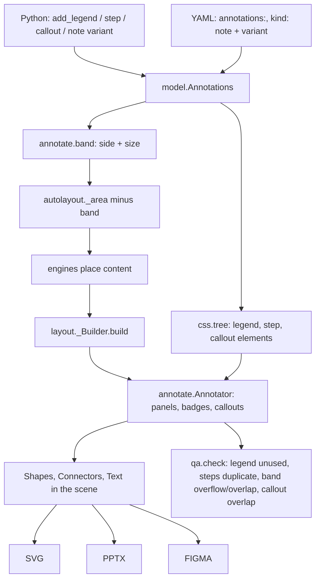

# Annotations Design

**Spec**: `.specs/features/annotations/spec.md`
**Status**: Approved

---

## Architecture Overview

Annotations are model data (`Diagram.annotations`) turned into ordinary scene primitives by one new module,
`spinagram/annotate.py`. Because the scene already renders natively in SVG, PNG, PowerPoint and Figma (rect and
pill shapes with labels, icons and shadows; connectors with markers; text), every annotation is native in every
backend without backend changes. CSS reaches annotations through new elements in the style tree.



Order inside `build`: zones → nodes → tables → edges → **step badges** → **panels** → **callouts** → chrome.
Callouts come last among content so they are placed against every other shape.

---

## Code Reuse Analysis

| Component | Location | How to Use |
| --------- | -------- | ---------- |
| `_Builder.pill`, `_decorate`, `_css`, `_text` | `src/spinagram/layout.py:58-96` | Badges are pills (w = h → circle); panels and bubbles are rect shapes decorated with computed CSS |
| `Connector` with markers | `src/spinagram/scene.py:110` | Legend edge samples, callout leader lines (`marker_end="circle"`) |
| `Label`/`TextBlock`/`wrap_paragraphs` | `src/spinagram/scene.py`, `text.py` | Panel rows, step texts, bubble text |
| `_area` | `src/spinagram/autolayout/__init__.py:236` | Subtract the band |
| `css.tree` / `compute` | `src/spinagram/css.py:521` | Add annotation elements; computed styles under keys `legend`, `step`, `callout:<i>` |
| `qa.check` / `Issue` | `src/spinagram/qa.py:49` | New checks fed by `scene.annotation_issues` |
| Node kind `note` | `src/spinagram/model.py:315` | Variants as a node attribute; CSS class added |

---

## Components

### model: Annotations

- **Location**: `src/spinagram/model.py`
- **Interfaces**:
  - `LegendSpec(title="Legend", items: dict[str, str] | None, position="right")`
  - `Step(n: int, text: str, edge: int | None, node: str | None)`
  - `Callout(target: str, text: str, title: str | None, kind="info", side="auto", cls=None, css=None)`
  - `Annotations(legend: LegendSpec | None, steps: list[Step], callouts: list[Callout])` as `Diagram.annotations`
  - `Diagram.add_legend(items=None, *, title="Legend", position="right")`
  - `Diagram.step(text, *, on, n=None)`; `on` = `Edge`, `Node`, node id, or `(src, dst)`; `Edge.step(text, n=None)`
  - `Diagram.callout(target, text, *, title=None, kind="info", side="auto", class_=None, css=None)`
  - `Diagram.note(..., variant="sticky")`; validated against `NOTE_VARIANTS`

### annotate module

- **Location**: `src/spinagram/annotate.py`
- **Interfaces**:
  - `legend_entries(d) -> list[Entry]` (key, label, kind node|edge|style|icon, element key or None)
  - `band(d, theme) -> tuple[str, float] | None` side and thickness before layout
  - `class Annotator(builder)`: `badges(connectors) -> list[Item]`, `panels() -> list[Item]`, `callouts(obstacles) -> list[Item]`, `issues -> list[tuple[str, str, str]]`
- **Constants**: `BAND_WIDTH = 360`, `BAND_GAP = 32`, `BADGE = 30`, `CALLOUT_W = 320`, `KINDS = {info: primary, tip: success, warning: warning, risk: alert}`

### Theme

- **Location**: `src/spinagram/themes/default/theme.yaml`
- **Adds**: colours `success`, `success-bg`, `success-text`; `defaults.annotations: {band: 360, gap: 32, badge: 30, callout_width: 320, title_size: 20, text_size: 16}`

### CSS elements

- **Location**: `src/spinagram/css.py`
- **Adds** under the root: `legend` (key `legend`), `step` (key `step:<n>`), `callout` (classes = kind + `class_`, key `callout:<i>`); note nodes get the variant as a class.

---

## Data Models

```python
@dataclass
class Annotations:
    legend: LegendSpec | None = None
    steps: list[Step] = field(default_factory=list)
    callouts: list[Callout] = field(default_factory=list)
```

YAML:

```yaml
annotations:
  legend: {title: Legend, position: right, items: {".security": Security control, "edge.async": Async}}
  steps: [{on: "users -> dns", text: Users resolve the domain}, {on: alb, n: 3, text: ...}]
  callouts: [{on: pvc, text: Snapshots every 6 h, kind: warning, side: auto}]
nodes:
  - {id: n1, kind: note, variant: card, title: Why, text: ...}
```

---

## Error Handling Strategy

| Error Scenario | Handling | User Impact |
| -------------- | -------- | ----------- |
| Unknown callout kind / note variant | `ValueError` naming allowed values | Spec load / build error |
| Step `on` matches no edge or node | `ValueError` naming the reference | Spec load error |
| Callout target from another diagram | `ValueError` | Build error |
| Legend key unused | Drawn from theme default; `check` issue | Warning in check |
| Panels exceed the band | Drawn clipped to content; `check` overflow | Warning in check |
| Callout has no free side | Placed on first side; `check` overlap | Warning in check |

---

## Risks & Concerns

| Concern | Location (file:line) | Impact | Mitigation |
| ------- | -------------------- | ------ | ---------- |
| `_Builder.build` is long and order-sensitive | `src/spinagram/layout.py:304` | New steps could disturb chrome/z-order | Annotations live in `annotate.py`; build only calls three methods at fixed points |
| `build_scene` is `lru_cache`d on the diagram | `src/spinagram/layout.py:441` | Mutable annotation lists must hash/compare like other fields | Dataclasses with `eq=True` default; covered by existing cache behaviour (diagram is copied in apply_layout) |
| Manual-layout diagrams have no area to shrink | `src/spinagram/autolayout/__init__.py:236` | Band can overlap content | Spec ANN-12: draw the band at the edge and report overlap |
| Golden SVG tests for unannotated diagrams | `tests/` | Accidental output change | No annotations → no new items; full suite gates every task |
| PowerPoint circle badges | `src/spinagram/backends/pptx.py` | Pill with w = h must stay a circle | Integration test inspects the PPTX shape geometry |

---

## Tech Decisions

| Decision | Choice | Rationale |
| -------- | ------ | --------- |
| Render path | Compose existing scene primitives | Native in all four backends with no backend code |
| Module boundary | One `annotate.py` | Keeps `layout.py` from growing further |
| Placement of callouts | Greedy side order with rectangle overlap tests | Deterministic, explainable, cheap |
