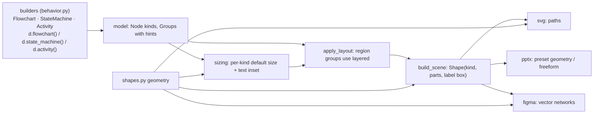

# Behavior Diagrams Design

**Spec**: `.specs/features/behavior-diagrams/spec.md`
**Status**: Approved (2026-10-12, "proceed with an MVP")

---

## Architecture Overview

Symbols are new node kinds whose geometry is defined once (`spinagram/shapes.py`) and consumed by the
scene and every backend. Builders are thin verb layers over the existing `Diagram` builder: they create
nodes of the new kinds, groups (composites, lanes, regions) and edges, and set the `layered` engine.

## Code Reuse Analysis

| Component | Location | How to Use |
| --------- | -------- | ---------- |
| `Diagram.add`, `group`, `edge`, operators | `src/spinagram/model.py` | Builders call them; regions are groups |
| `auto_size` | `src/spinagram/autolayout/sizing.py:13` | Extended with per-kind sizes/insets |
| `_Builder.box/diamond` | `src/spinagram/layout.py:91,124` | New `_Builder.symbol` for geometry kinds, reusing text block wrapping |
| SVG/PPTX/Figma shape writers | `backends/svg.py:92`, `backends/pptx.py:227`, `backends/figma.py:226` | Add a branch for geometry kinds |
| `qa.check` | `src/spinagram/qa.py:21` | Behavior rules added as model-level checks |

## Components

### `shapes.py`
- `GEOMETRY: dict[kind, Spec]` with `parts(x, y, w, h) -> list[Part]` (`Part(d: str, paint: "shape" |
  "solid" | "stroke")`, SVG path syntax, absolute coords), `text_box(x, y, w, h)`, `size` (fixed size for
  pseudostates or `None` for text-sized), `pptx` preset name.
- Kinds: terminator, process, decision, io, document, predefined, data, connector, initial, final,
  flow_final, fork, join, merge, choice, history, deep_history, state, action, object, signal_send,
  signal_receive (`note`, `diamond`, `box` keep their existing renderers).

### Scene
- `Shape.parts: list[Part] | None` filled for geometry kinds; label box from `text_box`.
- `Shape.anchor` for circles/diamond-like kinds uses side midpoints (existing diamond rule generalised).

### Backends
- SVG: one `<path>` per part with paint rules (shape: style fill/stroke; solid: stroke colour fill; stroke: no fill).
- PPTX: preset autoshape when the spec names one (`OVAL`, `FLOWCHART_TERMINATOR`, `PARALLELOGRAM`,
  `FLOWCHART_DOCUMENT`, `FLOWCHART_PREDEFINED_PROCESS`, `CAN`, `FLOWCHART_CONNECTOR`, `DIAMOND`,
  `PENTAGON`, `FLOWCHART_SUMMING_JUNCTION`, `ROUNDED_RECTANGLE`, `RECTANGLE`); multi-part symbols
  (`final`) become a group of native shapes; others a freeform polygon (curves flattened).
- Figma: vector network per part converted from the path (lines and cubic segments).

### `behavior.py`
- `Flowchart(Diagram)`, `StateMachine(Diagram)`, `Activity(Diagram)`: standalone, default
  `layout={"engine": "layered", "direction": "down"}`.
- Verb mixins `_FlowVerbs`, `_StateVerbs`, `_ActivityVerbs` operate on `self._d` (target diagram) inside
  `self._scope()` (the region group, or nothing when standalone).
- Regions: `Diagram.flowchart/state_machine/activity(title, **layout)` → context manager yielding a
  region object (verbs + group) whose group carries hints `engine=layered`, `direction`, `region=type`.
- Composite states: `sm.composite(title)` → group style `state` with its own `initial`/`final`;
  `c.region()` → nested group style `region` (dashed outline).
- Activity: `parallel()`/`branch()`/`sequence()` via a collector stack (units of `(entry, exit)`);
  `lane(title)` reuses an existing lane group; the activity container gets hint `lanes=True` when lanes exist.
- `Node.yes/no/on` helpers compose edge labels.

### Checks
- `behavior_issues(diagram) -> list[Issue]` for decisions < 2 out-edges, forks with 1 branch, regions
  without initial; build-time `ValueError` for edges out of finals / into initials and duplicate region ids.

## Risks & Concerns

| Concern | Location (file:line) | Impact | Mitigation |
| ------- | -------------------- | ------ | ---------- |
| 22 kinds × 3 backends | backends | Large surface | Geometry once in `shapes.py`; PPTX presets table; one generic path→vector converter for Figma |
| PPTX freeform cannot draw curves | python-pptx `FreeformBuilder` | Curved custom symbols become polygons | Presets cover every curved kind; flatten only for polygons |
| Builders' state (collectors, lanes) is implicit | `behavior.py` | Confusing errors | Clear `ValueError`s; tests per verb |

## Tech Decisions

| Decision | Choice | Rationale |
| -------- | ------ | --------- |
| Region implementation | Group + layout hints, laid out by its own engine | Reuses groups, zones and containment |
| Orthogonal regions in composites | Dashed nested boxes (MVP) instead of divider lines | No zone-divider primitive yet; SPEC_DEVIATION noted for BHV-14 |
| YAML regions (BHV-27) | Deferred from MVP | Python is the primary UI; YAML follows |
