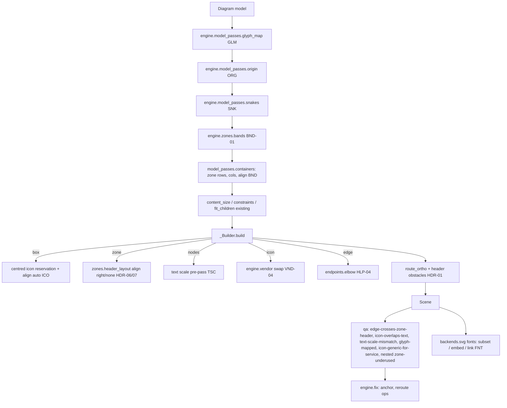

# Consul Diagram Improvements Design

**Spec**: `.specs/features/consul-diagrams/spec.md`
**Status**: Approved

---

## Architecture Overview

Every scenario fits the staged-pass architecture of 0.4 (`spinagram.engine`). New work is either a **model pass**
(geometry decided on a copy of the `Diagram` before `_Builder`), a **builder helper** (per element), a
**scene pass** (routing), a **`qa` diagnostic** (with an optional fix), or a **backend option**. No new
package. `layout.py` only gains calls.



Model pass order inside `model_passes.apply`: `glyph_map` → `origin` → `snakes` → `bands` → `containers` →
`content_size` → `constraints` → `fit_children`. Glyph mapping runs first so every later measurement sees
final text. Origin runs before anything that reads canvas coordinates, because bands and snakes default to the
safe area in canvas coordinates. `apply` gains the triggers `d.origin == "safe"`, `d.snakes`, any `z.band`,
and a theme glyph map.

---

## Code Reuse Analysis

| Component | Location | How to Use |
| --------- | -------- | ---------- |
| `route_ortho` / `autolayout.route.route(obstacles=…)` | `engine/route.py:45`, `autolayout/route.py:33` | Pass header rects as extra obstacles (HDR-01) |
| `segment_hits`, `polyline` | `qa.py:57,83` | Header crossing test (HDR-02) and anchor-fix candidates |
| `endpoints.resolve`, `straight_refs` | `engine/endpoints.py` | Anchor-fix candidate segments; elbow exit side from `Binding.side` |
| `zones.header_layout`, `header_options` | `engine/zones.py:47,63` | Mirror for `align: right`; `none` short-circuits |
| `model_passes.containers`, `min_width` | `engine/model_passes.py:39,20` | Zone-attached containers reuse sizing, `max_width` error |
| `zones.content_top`, `FIT_PADDING` | `engine/zones.py:86,92` | Zone content area for rows and snakes |
| `textfit.fit_blocks` | `engine/textfit.py:110` | Icon-shrink loop calls it per icon size; text-scale pre-pass reads `FitResult.size` |
| `icon_fit.place` | `engine/icons.py` | Centred icon at the shrunk size |
| `qa.fix_for`, `engine/fix.apply_to_diagram`, `suggest_python` | `qa.py:296`, `engine/fix.py` | New ops `anchor`, `reroute` |
| `Theme.icon` trace (`scene.icon_sources`) | `theme.py:223` | Source of a node icon (official vs theme/concept) for VND |
| `icons.index(pack, auto_fetch=False)`, `metadata.PROVIDERS` | `icons.py:433`, `metadata.py:15` | Cached vendor indexes only |
| `_resolve_dir` | `theme.py:38` | Extended search chain + error listing |
| SVG `@font-face` writer, `Scene.fonts()` | `backends/svg.py:237` | Subset/link modes |
| `yaml_io.from_dict`, `_CONTAINER_KEYS`, `dump` | `yaml_io.py` | Parity keys; `dump` must round-trip the new fields |

### Integration Points

| System | Integration Method |
| ------ | ------------------ |
| Python DSL | `Zone.at/top/...`, `Zone.band`, `Diagram.__getitem__`, `distribute`, `snake`, `origin`, `Edge.mid`, container `zone/align/cols/same_text_scale` |
| YAML | `origin`, `band`, `rows[].zone/align/cols/same_text_scale`, `snakes`, `route: elbow`, `mid`, `align: auto`, zone `header: right|none` |
| Theme | `defaults.node.icon_text_gap/icon_min`, `text.glyph_map`, `icons.prefer_vendor_for_services`, `SPINAGRAM_THEME_PATH`, entry points |
| CLI | `render --fonts subset|embed|link`; `check --fix` applies `anchor`/`reroute` |

---

## Components

### HDR: header obstacles, crossing rule, header align (#1)
- **Router**: `_Builder.route_edges` passes `self.headers` to `router.route_ortho(..., headers=…)`. For each edge the obstacle list is node boxes plus every header except the headers of zones bound at either end (`Binding.target == "zone"`).
- **Rule** `qa.header_crossings(scene)`: for each connector, for each `(zid, rect)` in `scene.zone_headers`, skip when an end binds to zone `zid` and only the segment touching that end hits the rect. Report on the first hit per (edge, zone).
- **Fix** `qa._anchor_fix(scene, edge)`: needs node ids at both ends (`Binding.target == "node"`). Fractions in spec order, sides from the current bindings. A candidate segment must not `segment_hits` any header or a node other than its ends. Else `reroute`.
- **Apply** `engine/fix.py`: `SAFE_OPS += ("anchor", "reroute")`; `anchor` sets `edge.src/dst` strings; `reroute` sets `edge.route`. `suggest_python` prints `e7: src="a.bottom@0.85", dst="b.top@0.85"` / `e7: route="ortho"`.
- **Header align**: `Zone.header` accepts a string (`"left"|"right"|"none"`), normalised to `{"align": …}` in `header_options`. `header_layout` mirrors x positions for `right`; the builder emits the label with `anchor="end"`; `none` returns no items and the builder skips `self.headers[...]`. `content_top` for `none` = `z.y + padding`.

### ICO: centred icon (#2)
- **Builder** `_Builder.box`, centred branch with text: loop `isz` from the current size down to `icon_min`, compute `top = 16 + isz + gap`, try `fit_blocks(mode="none"-like wrap only)` at base size. The first size whose blocks fit the height wins; otherwise keep `icon_min` and run the normal `self.fit`. Implemented as helper `icon_fit.centre_layout(...) -> (isz, top)` to keep `box` short.
- **align auto**: resolved at the top of `box`: `center = n.align == "center" or (n.align == "auto" and n.h > n.w and fits_centred)`, where `fits_centred` is the same helper's `ok` at base size.
- **Rule** `qa.icon_text_issues(scene)`: first block's first line rect from `Label.place()` (x by anchor and `measure`, y = top … top + leading). Overlap with `_icon_rect`. Fix: `resize` with `h = s.h + overlap + gap`.

### BND: bands and zone rows (#3)
- **Model**: `Zone.band: tuple | None`; `Container` gains `zone: str | None`, `align: str | None`, `cols: int | None`, `same_text_scale: bool | None`; `x`/`y` become `float | None`.
- **DSL**: `row/column(items=None, *, x=None, y=None, …)`. Inside an open zone the container records `zone=<zone id>`; with `items` and no `w/h` (or no x/y) the items are created inside the container context. Outside a zone, missing x/y → `TypeError`.
- **Pass** `zones.bands(d, theme)` sets band zones' geometry. `containers` then, for zone containers, computes the content area (via `content_top` with theme header options), defaults `max_width`, applies `cols` widths, and places by `align` after sizing.

### ZAN (#4)
- `Zone.at/top/bottom/left/right/at_*` mirror `Node`; they return `zone:<id>.<side>[@f]`, already parsed by `endpoints.resolve`.

### SNK (#5)
- **Model** `Snake(dataclass)`: `nodes: list[str]`, `zones: list[str]`, `cols, x, y, w, h, gap, row_gap, mode`. `d.snake` creates nodes (w=h=0 placeholders, `extra["snake"]=True` not needed), zones (`fit=None`, placeholder geometry), and edges: in-row edges plain, turn edges `route="ortho"`. Returns nodes.
- **Pass** `model_passes.snakes(d, theme)`: computes the row width (`w` or canvas − 2·margin), the zone pad/head (`content_top` with theme options), then each zone rect and card x/y/w/h; reverses odd rows in boustrophedon. In-row edges become explicit side anchors (`a.right → b.left` or reversed) so they stay straight.

### VND (#6)
- New module `engine/vendor.py`: `match(title, packs) -> str | None` (cached indexes via `icons.index(p, auto_fetch=False)`, n-grams, ordering); `is_generic(source) -> bool` (`source != "official"`).
- **Builder**: in `box`, when `prefer_vendor_for_services` and the node icon resolves with a non-official source and `match` hits, use the vendor ref. Record `self.vendor_hints[node] = (ref, icon)` for non-swapped cases → `scene.vendor_hints` → `qa`.

### GLM (#7)
- `model_passes.glyph_map(d, theme)`: walks every text field listed in GLM-01, replaces chars, records `d.meta["glyph_mapped"] = {ch: repl}` for chars seen. `build_scene` copies it to `scene.glyph_mapped`; `qa.check` emits `glyph-mapped`. Validation in `Theme.load` (`text.glyph_map` keys are single chars).

### ORG (#8)
- `Diagram.origin: str = "canvas"`, validated in `__post_init__`. `model_passes.origin(d, theme)` translates the fields in ORG-01 by the margin and sets `origin="canvas"` on the copy (idempotent).

### ZUN (#9)
- `qa.zone_issues`: new helper `_content(z, kids_nodes, child_zones)`. The used area is the sum of the child zones' areas clipped to the content area, plus the nodes not inside a child zone. Undeclared detection mirrors the node rule for zones.

### TSC (#10)
- **Builder pre-pass** `_Builder.shared_text_scale()` before the node loop: for each container with an effective `same_text_scale`, build each member on a scratch builder (`copy.copy(self)` with fresh dicts), read the fitted sizes per role, then set `title_size`/`body_size` on the members of the resolved copy to the minimum. The diagram passed to the builder is already a copy, so the spec is never mutated.
- **Rule**: `scene.text_sizes[node] = (title, body)` and `scene.rows` already list the members → `text-scale-mismatch` when the flag is off.

### HLP (#11)
- `Diagram.__getitem__`, `Diagram.distribute`, `Edge.mid`; `Diagram.edge` validates `route`.
- Builder: `route == "elbow"` (no via/curve) → `endpoints.elbow(p1, b1, p2, mid)` → points, `route="poly"`.

### THM (#12)
- `theme._resolve_dir(ref, relative_to)`: builds `searched: list[str]` while trying built-in, path, `SPINAGRAM_THEME_PATH` entries, and entry points (`importlib.metadata.entry_points(group="spinagram.themes")`). Raises `FileNotFoundError` with the numbered list.

### FNT (#13)
- `backends/svg.py`: `SvgBackend(fonts="subset")` / `to_svg(scene, fonts="subset")`. It collects the used characters per `(family, weight, italic, file)` from blocks and runs (fallback runs count for their own font). New module `backends/fontsubset.py`: `subset(path, chars) -> (bytes, mime)` using `fontTools.subset` with `Options(name_IDs=["*"], recalc_timestamp=False, notdef_outline=True)` and `flavor=None`, cached by `(path, frozenset(chars))`. On error it returns the original bytes and warns. Link mode emits `@import url('https://fonts.googleapis.com/css2?family=<Family>:ital,wght@…&display=swap');` per family.
- CLI `render --fonts` → `backend_options["svg"]["fonts"]`; the PNG backend renders the SVG produced with the same option.

---

## Data Model Changes

```python
@dataclass
class Zone:  # new fields
    band: tuple[float, float] | None = None
    header: dict | str | None = None        # str: "left" | "right" | "none"

@dataclass
class Container:  # new / changed fields
    x: float | None
    y: float | None
    zone: str | None = None
    align: str | None = None                 # center | start | end (None: center in a zone, start otherwise)
    cols: int | None = None
    same_text_scale: bool | None = None      # None: same_size

@dataclass
class Snake:
    nodes: list[str]; zones: list[str]; cols: int; y: float; h: float
    x: float | None = None; w: float | None = None; gap: float = 40; row_gap: float = 60
    mode: str = "boustrophedon"

@dataclass
class Edge:  # new field
    mid: float | None = None                 # elbow middle segment coordinate

@dataclass
class Diagram:  # new fields
    origin: str = "canvas"
    snakes: list[Snake]
```

Scene gains: `vendor_hints: dict[str, tuple[str, str]]`, `glyph_mapped: dict[str, str]`,
`text_sizes: dict[str, tuple[float | None, float | None]]`, `text_scale_rows: set[str]` (containers with the flag on).

---

## Error Handling Strategy

| Error Scenario | Handling | User Impact |
| -------------- | -------- | ----------- |
| `band` + `fit="children"` | `ValueError` at model pass | Clear message naming the zone |
| Row wider than zone | 0.4 `cannot fit … in Npx` `ValueError` | Same message as other rows |
| `cols` < members | `ValueError` | Names the zone row |
| Snake zones count ≠ rows | `ValueError` | Names expected count |
| Unknown `origin` / `route` / `header` / snake `mode` | `ValueError` listing valid values | Immediate at build |
| Theme not found | `FileNotFoundError` listing every searched place | Shows where to put the theme |
| Font subset fails | Embed whole font + `warnings.warn` | Bigger file, same look |
| Glyph map key not one char | `ValueError` at theme load | Theme author fixes the key |

---

## Tech Decisions

| Decision | Choice | Rationale |
| -------- | ------ | --------- |
| Header crossing fix | Anchor fractions first, `reroute` to ortho second | Keeps straight edges straight when a nearby fraction clears; ortho always clears (HDR-01) |
| Snake placement | Model pass, not DSL-time | Needs the theme margin and header height |
| Text-scale pre-pass | Scratch builder per member | Reuses the exact fit path; no duplicated sizing logic |
| Font subsetting | fontTools (already a dependency), cached per char set | No new dependency; deterministic with `recalc_timestamp=False` |
| Theme packages | `importlib.metadata` entry points | Standard; no import side effects until needed |
