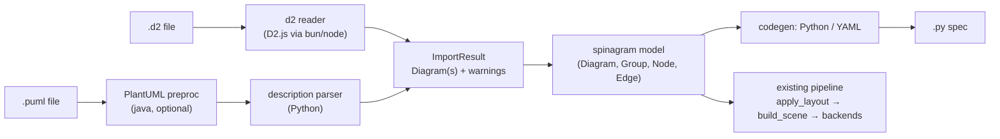

# Diagram Import Design

**Spec**: `.specs/features/diagram-import/spec.md`
**Status**: Parked 2026-10-12 (approach A confirmed; resume after behavior-diagrams and css-styling)

---

## Research (feasibility evidence, 2026-10-11)

### D2

- The native `d2` CLI (v0.9.0 on this machine) renders SVG/PNG/PDF only; it has no AST or JSON export.
  spinagram's d2 *layout engine* already reads geometry back from d2's SVG
  (`src/spinagram/autolayout/engines/d2.py:1`), which is fragile ("SVG is not a public API").
- **D2.js** (`@terrastruct/d2` 0.1.33, MPL-2.0, official WASM build) exposes `compile(source | {fs, inputPath})`.
  Its result has `diagram` (the d2target IR) and `graph`. Verified locally with bun:
  - `diagram.shapes[]`: `id` (dotted path, e.g. `aws.api`), `type` (`rectangle`, `person`, `cylinder`, …),
    `label`, `pos`, `width`, `height`, `level` (nesting depth), `icon.Path`, `fill`, `stroke`,
    `strokeDash`, `borderRadius`, `tooltip`, `link`, `labelPosition`, `fields`/`columns` (class, sql_table) …
  - `diagram.connections[]`: `src`, `dst`, `label`, `strokeDash`, `srcArrow`, `dstArrow`, `route` (laid-out points).
  - Vars, globs, classes and imports are resolved by the compiler (imports through the `fs` map).
- Conclusion: parse D2 with D2.js under bun/node, exactly like `elkjs` (`autolayout/engines/elk.py:56`
  installs a pinned npm package into the cache). No Python D2 parser exists; writing one would mean
  re-implementing vars, globs, classes and imports.

### PlantUML

- No AST/JSON export and no maintained Python parser (JS `plantuml-parser` is a partial PEG for class
  diagrams; a PHP one is abandoned). Output types are images, `txt`, `preproc`, `xmi` (class only).
- `plantuml-mit-1.2026.8.jar` (MIT) verified locally with Java:
  - `--preproc` writes the source after `!include` / `!define` / stdlib expansion. C4 macros become plain
    syntax: `rectangle "== API\n//<size:12>[Python]</size>//\n\nServes orders" <<container>> as api`,
    `database "…" <<container>> as db`, `rectangle … <<system_boundary>> as s { … }`, `user -->> api : **Uses**…`.
  - `-tsvg` output carries structure metadata: `<svg data-diagram-type="DESCRIPTION">`,
    `<g class="cluster" data-qualified-name="aws.vpc">`, `<g class="entity" data-qualified-name="aws.vpc.api">`,
    `<g class="link" data-entity-1="ent0001" data-entity-2="ent0004" data-link-type="dependency">`, with the
    drawn geometry inside each group.
- Conclusion: own parser for the *description* grammar (component, deployment, use case — what C4 expands to)
  over `--preproc` output; `data-diagram-type` detects unsupported families; SVG metadata supplies source
  positions for `--keep-layout` (P2).

### Mapping gaps found in spinagram

| Source concept | spinagram today | Gap |
| -------------- | --------------- | --- |
| Shape kinds (cylinder, person, cloud, circle, hexagon, queue, document) | Scene draws `rect`, `diamond`, `pill` only (`src/spinagram/layout.py:56-129`) | **P1 (user decision)**: new kinds in model, scene, SVG, PPTX (`prstGeom can/ellipse/hexagon/cloud/flowChartDocument`), Figma; others box + warning |
| Per-element fill/stroke/font colour | Node `style` only; `color` applies to pills/text (`model.py` Node) | P2: `fill`, `stroke` overrides on Node and in `build_scene` |
| Containers | `Group` + `with d.group()` | None |
| Remote icon URLs | `icon` is `pack:name` or a local path | P1: map `icons.terrastruct.com/<path>` through the terrastruct pack rules (`icon_packs/terrastruct.yaml:16`); others warn. Later: URL icons with cache |
| Edge arrows, labels, dashes | `Edge.arrow`, `label`, `dashed` | None |
| Edge arrowhead shapes (diamond, circle, crow's foot) | Triangle only | Warn |
| Direction | `layout.direction` right/down | left/up approximated (warn) |
| Notes (PlantUML `note`, D2 `text` shape) | `kind: note` | Note attached to an element: create note + dashed edge |
| Tooltips, links | None | Warn (P1); SVG `<title>` possible later |
| D2 layers/scenarios/steps | One diagram per spec | One diagram per board |
| D2 `grid-rows/columns`, `near`, `width/height` | Group `columns`; node `w/h` imply manual layout | `columns` (P3); `near` warn; size ignored (auto-size) |
| sql_table / class shapes | `Table` is fixed-position | Warn in P1 (render as box listing fields as body lines) |
| Python source output | `yaml_io.dump` writes frozen YAML (no groups) | New code generator (Python) and a non-frozen YAML writer |

---

## Approach Exploration

All three deliver the same scope; they differ in how sources are parsed.

**A. Toolchain-backed parsing (recommended).** D2 via D2.js (bun/node, pinned npm package in cache);
PlantUML via own description-grammar parser over `--preproc` output (Java optional, needed only for
`!include`/C4). Exact D2 semantics, small PlantUML parser, both reuse existing cache/install patterns.
Cost: runtime dependencies (bun/node for D2; Java for C4).

**B. Pure-Python parsers for both.** No external runtimes. Cost: a D2 parser with vars, globs, classes,
imports, maps and edge-key syntax is a large, permanently moving target; C4/stdlib includes cannot be
expanded without reimplementing PlantUML's preprocessor. Fidelity lower, maintenance highest.

**C. Render-then-scrape SVG.** Run the native tools to SVG and read structure + geometry from SVG metadata
(D2: base64 path classes as in the existing d2 engine; PlantUML: `entity`/`cluster`/`link`). Cost: labels,
kinds and stereotypes must be recovered from drawn text; D2 SVG is not a public API; needs the native `d2`
binary and Java always.

Recommendation: **A**, with C's PlantUML SVG metadata used only for `--keep-layout` (P2).

---

## Architecture Overview



Every reader produces the existing `Diagram` model; nothing downstream knows the source format.

---

## Code Reuse Analysis

### Existing Components to Leverage

| Component | Location | How to Use |
| --------- | -------- | ---------- |
| `Diagram` builder (`box`, `group`, `edge`) | `src/spinagram/model.py` | Readers build models through the public builder, so ids and groups follow normal rules |
| Spec loading by suffix | `src/spinagram/yaml_io.py:150` (`load`) | Add `.d2` and `.puml`/`.plantuml`/`.pu` dispatch |
| Pinned npm install into cache, runtime detection, lock | `src/spinagram/autolayout/engines/elk.py:28-80` | Extract to a shared `jsrun` helper; install `@terrastruct/d2` the same way |
| Cache root, offline flag, download with lock | `src/spinagram/icons.py` (`cache_root`, `fetch`) | Jar download and `SPINAGRAM_OFFLINE` handling |
| Terrastruct pack rules | `src/spinagram/icon_packs/terrastruct.yaml` | Map D2 icon URL paths to `terrastruct:` names without hard-coding |
| Freeze to YAML | `src/spinagram/yaml_io.py:173` (`dump`) | Reference for the YAML writer; P2 non-frozen variant |
| Spec discovery in the UI | `src/spinagram/ui/workspace.py:90` (`SPEC_EXTS`) | Add import suffixes so `serve` watches them |

### Integration Points

| System | Integration Method |
| ------ | ------------------ |
| CLI | New `import` subcommand; `render/check/facts/layout/serve` gain the suffixes through `load` |
| Python API | `spinagram.load()` handles the suffixes; `spinagram.importers.from_d2(text)`, `from_plantuml(text)` |
| Live UI | Watches `.d2`/`.puml`; conversion warnings shown like icon warnings |

---

## Phase Plan

1. **Native shapes** (IMP-27, 37-40): model, scene geometry and text inset, SVG, PPTX, Figma, Python/YAML API.
2. **Import core**: `importers` package, `ImportResult`/warnings, code generator (Python), `import` CLI, report (IMP-21-24, 31, 32, 34).
3. **D2 frontend** (IMP-01-09, 36, 41): shared `jsrun` extracted from ELK, D2.js runner, IR mapping, icon URL mapping, boards.
4. **Direct loading** (IMP-18-20): `load()` suffix dispatch, CLI commands, `serve` watching.
5. **PlantUML frontend** (IMP-10-17, 33, 35): jar provisioning, preproc, parser, diagram-type detection, C4 fixtures.
6. P2/P3 later: YAML output, `--keep-layout`, colour overrides, activity diagrams, D2 grids.

---

## Components

### `spinagram.importers` (package)

- **Purpose**: Convert foreign diagram sources into `Diagram` objects plus warnings.
- **Location**: `src/spinagram/importers/`
- **Interfaces**:
  - `load_file(path: Path) -> ImportResult` - dispatch by suffix
  - `ImportResult(diagrams: list[Diagram], warnings: list[ImportWarning])`
  - `ImportWarning(file: Path, line: int | None, construct: str, message: str)`
- **Dependencies**: model, icons
- **Reuses**: `Diagram` builder

### D2 reader

- **Purpose**: D2 source → D2.js `compile` → IR JSON → `Diagram`.
- **Location**: `src/spinagram/importers/d2.py`, `src/spinagram/importers/d2_runner.mjs`
- **Interfaces**: `read_d2(path: Path) -> ImportResult`
- **Dependencies**: bun or node; `@terrastruct/d2` pinned, installed into `<cache>/d2js`
- **Reuses**: ELK install/run pattern (extracted to `spinagram/jsrun.py`)
- **Notes**: shapes ordered by `level` then source order; `id` path splits into group chain; `type` mapping
  table; icon URL mapping; board recursion for layers/scenarios/steps; line numbers from `graph` references.

### PlantUML reader

- **Purpose**: PlantUML source → (optional `--preproc`) → description-grammar parse → `Diagram`.
- **Location**: `src/spinagram/importers/plantuml.py`
- **Interfaces**: `read_plantuml(path: Path) -> ImportResult`; `preprocess(path) -> str | None`
- **Dependencies**: Java + jar only when the file uses `!include`/`!define`/`!procedure`
- **Notes**: line-oriented tokenizer (declarations, `as`, stereotypes, `{`/`}`, relations with arrow
  grammar `[<]?[-.]+(left|right|up|down)?[-.]*[>]?`, `:` labels, `note … end note`, `skinparam`/`hide` ignored);
  creole cleanup (`**`, `//`, `<size:…>`, `\n`); diagram-type detection by first keyword plus, with Java,
  `data-diagram-type` from SVG.

### Code generator

- **Purpose**: `Diagram` → readable Python spec (P1) and YAML spec (P2).
- **Location**: `src/spinagram/codegen.py`
- **Interfaces**: `to_python(d: Diagram, header: list[str]) -> str`; `to_yaml(d: Diagram) -> str`
- **Notes**: nested `with d.group(...)` blocks mirror groups; nodes bound to variables only when an edge
  uses them; chains collapse to `a >> b >> c`, labelled edges use `.to(b, "label")`; output passes
  `ruff check` (verified in tests); deterministic ordering. Also useful standalone (YAML → Python).

### CLI `import`

- **Purpose**: `spinagram import PATH... [-o OUT] [--to python|yaml] [--strict] [--keep-layout]`.
- **Location**: `src/spinagram/cli.py`
- **Notes**: one output per input (`-o` dir for many); prints warnings and the summary line.

---

## Data Models

```python
@dataclass
class ImportWarning:
    file: Path
    line: int | None
    construct: str      # "shape:hexagon", "style.fill", "tooltip", "note", "sprite"
    message: str

@dataclass
class ImportResult:
    diagrams: list[Diagram]
    warnings: list[ImportWarning]
```

P1 model addition: `Node.kind` values `cylinder | ellipse | hexagon | cloud | person | document`, with
`Shape.kind` carrying the same names to backends and a per-kind text inset in the scene.
P2 model addition: `Node.fill`, `Node.stroke` overrides.

---

## Error Handling Strategy

| Error Scenario | Handling | User Impact |
| -------------- | -------- | ----------- |
| No bun/node for D2 | `RuntimeError` with hint (same as ELK `HINT`) | Exit 1, names bun/node |
| D2 compile error | D2.js error text + line passed through | Exit 1, D2's message |
| No Java with `!include` | Clear error before parsing | Exit 1, "Java is required for included files" |
| Unsupported PlantUML family | Detect type, list supported | Exit 1 |
| Offline and toolchain missing | Refuse download, name the env var | Exit 1 |
| Subprocess > 60 s | Kill, error | Exit 1 |
| Approximated construct | `ImportWarning` | Warning lines; exit 0 (1 with `--strict`) |

---

## Risks & Concerns

| Concern | Location (file:line) | Impact | Mitigation |
| ------- | -------------------- | ------ | ---------- |
| D2.js IR shape is an internal d2target struct, not a documented API | `@terrastruct/d2` `compile()` result | Field renames on upgrade break the reader | Pin the version; fixture tests over the IR; reader reads only the fields listed above |
| ELK install code is engine-private | `src/spinagram/autolayout/engines/elk.py:56` | Duplicating it for D2.js doubles maintenance | Extract `jsrun.ensure_npm(package, version)` first; ELK switches to it |
| PlantUML grammar is large and loosely specified | — | Parser misses variants (arrow forms, quoting) | Scope to description diagrams; corpus-driven tests; unknown lines become warnings, never crashes |
| `--preproc` executes PlantUML on user files (`!include` URLs fetch over the network) | jar subprocess | Network access during import | Run the jar with a restrictive `PLANTUML_SECURITY_PROFILE` (e.g. `ALLOWLIST`; exact values to verify against plantuml.com/security before implementing) unless the user opts in; document it |
| Six new shape kinds touch the scene and three backends | `layout.py:56-129`, `backends/svg.py:92`, `backends/pptx.py`, `backends/figma.py` | Largest MVP slice; text-area fitting per shape can overflow | Shape geometry and inner text box defined once in the scene layer (`Shape.kind` + text inset); backends only map kinds; `check` overflow tests per kind |
| Generated Python could shadow builtins or collide | codegen | Invalid or confusing code | Name sanitizer with keyword/builtin list; `ruff` in tests |

---

## Tech Decisions (only non-obvious ones)

| Decision | Choice | Rationale |
| -------- | ------ | --------- |
| D2 parsing | D2.js (WASM) via bun/node | Only official machine-readable output; exact semantics |
| PlantUML parsing | Own parser over `--preproc` | No AST export; preproc makes C4 plain syntax |
| Layout | Re-layout by default | Themed, canvas-fitting output; `--keep-layout` later |
| Shapes | Native kinds in MVP | User chose fidelity (2026-10-12) |
| Order | D2 + shared pipeline, then PlantUML | Structured D2.js JSON de-risks the pipeline first |
| Output | Python first, YAML P2 | Python is the primary authoring UI |
