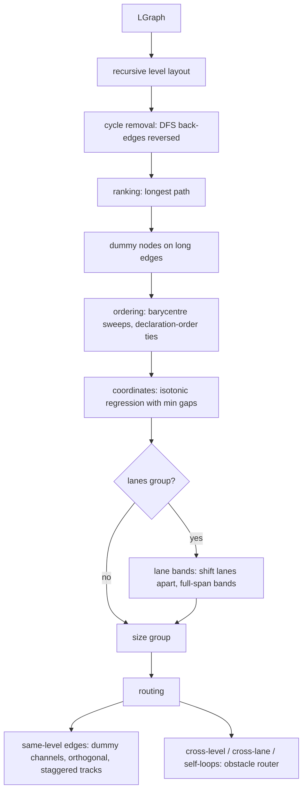

# Layered Layout Design

**Spec**: `.specs/features/layered-layout/spec.md`
**Status**: Approved (2026-10-12, "proceed with an MVP")

---

## Architecture Overview

A new engine `layered` implements the existing `LGraph → LResult` protocol
(`src/spinagram/autolayout/graph.py`), registered next to `flex`, `dot`, `elk`, `d2`. It lays out each
group level recursively: a group's direct children (nodes and already-laid-out child groups, as fixed
blocks) are ranked, ordered and placed with a Sugiyama pipeline; the group is then sized from its
content plus padding and becomes a block for its parent.

Direction `right` runs the same pipeline on transposed sizes and transposes the result.

## Code Reuse Analysis

| Component | Location | How to Use |
| --------- | -------- | ---------- |
| Engine protocol, registry | `src/spinagram/autolayout/engines/__init__.py` | Register `layered` as a built-in |
| `build_graph` / `apply_layout` | `src/spinagram/autolayout/__init__.py:93,193` | Sizes, area offset, route binding, label point already exist; add loops, lanes/engine hints, per-group engines |
| `_label_point`, `_side`, `_simplify` | `src/spinagram/autolayout/__init__.py` | Route → `via` binding unchanged; label placement extended to avoid boxes |
| Engine invariants tests | `tests/test_autolayout.py:153` | Parametrise with `layered` |

## Components

### `engines/layered.py` — `LayeredEngine`
- **Interfaces**: `available() -> None`; `run(graph: LGraph) -> LResult`.
- Level layout: `_level(children, edges) -> (boxes, routes, size)`; helpers `_break_cycles`, `_rank`,
  `_insert_dummies`, `_order`, `_coords` (pool-adjacent-violators), `_route_level`.
- Lanes: a group with hint `lanes=True` lays out the union of its lane children's members at one level;
  ordering key is (lane index, barycentre); after coordinates each lane is shifted so bands do not
  overlap; lane boxes span the full rank extent.
- Self-loops: `LGraph.loops` (new, default empty, ignored by other engines) reserve `loop_w` beside the
  node during coordinates and are routed as a 3-segment loop on the right (down) or bottom (right) side.

### `autolayout/route.py` — orthogonal obstacle router
- **Interfaces**: `route(src_box, dst_box, obstacles, *, prefer) -> list[point]`.
- Sparse grid from obstacle borders ± margin and port lines; A* with bend penalty; never enters an
  obstacle; used for edges whose endpoints live in different blocks or lanes.

### `apply_layout` changes
- `build_graph`: collect self-edges into `LGraph.loops`; pass group hints `lanes`, `engine`, `direction`.
- Per-group engines: a group whose hints carry `engine`/`direction` is laid out first as its own `LGraph`
  (recursively), replaced by a fixed block in the parent graph, then translated into place; edges that
  cross its border are re-routed with `route.py` on the final geometry.
- Label placement: candidates along the route (segment midpoints, then offsets) — first whose pill box
  intersects no node box.

## Data Models

`LGraph.loops: list[LEdge]` (new, default `[]`). Group hints gain `lanes: bool`, `engine: str`,
`direction: str` (existing hints dict).

## Error Handling Strategy

| Error Scenario | Handling | User Impact |
| -------------- | -------- | ----------- |
| Content larger than area | Existing overflow meta → `check` issue (LAY-20) | `check` reports px |
| > 300 nodes | `warnings.warn` naming the bound (LAY-22) | Warning, layout completes |
| Router finds no path | Fall back to straight elbow | Edge drawn, may cross |

## Risks & Concerns

| Concern | Location (file:line) | Impact | Mitigation |
| ------- | -------------------- | ------ | ---------- |
| Router cost on large graphs | `route.py` | Slow layouts | Router only for cross-block edges; same-level edges use dummy channels |
| `flex` ignores edges entirely | `engines/flex.py:1` | Users keep getting poor flows on plain diagrams | Out of scope; builders default to `layered`; docs point to `layout={"engine": "layered"}` |
| Label pills larger than rank gap | `__init__.py:131` | Labels overlap boxes | Rank gap already grows with widest label; label placement checks intersections |

## Tech Decisions

| Decision | Choice | Rationale |
| -------- | ------ | --------- |
| Coordinate assignment | Isotonic regression (PAV) toward neighbour medians, 4 alternating passes | Optimal per pass under ordering + gap constraints, deterministic, simple |
| Long edges | Dummy nodes, one per spanned rank | Reserves channels so orthogonal routes never cross nodes |
