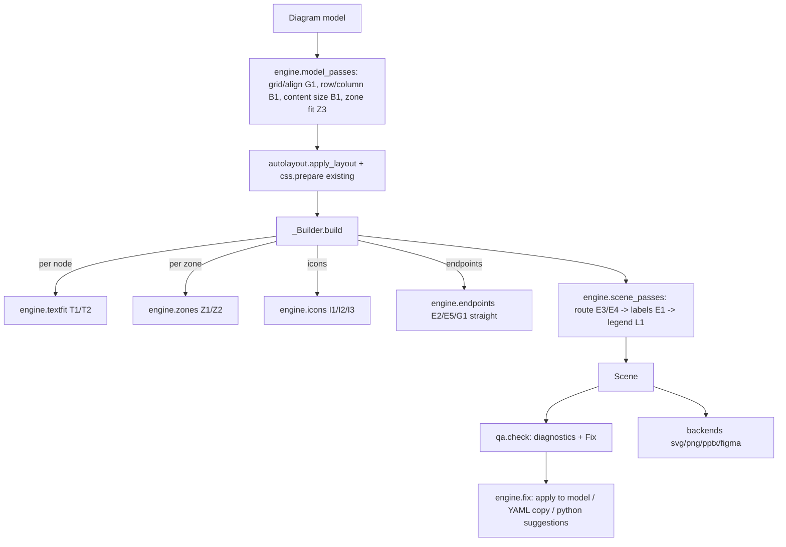

# Layout Engine Improvements Design

**Spec**: `.specs/features/layout-engine/spec.md`
**Status**: Approved

---

## Architecture Overview

Approaches considered (all deliver the same scope):

1. **Staged passes in a new `spinagram/engine/` package (chosen).** Model passes run on a copy of the
   `Diagram` before `_Builder` (grid/align, containers, content sizing, zone fit); `_Builder` calls focused
   helpers for per-element work (text fit, zone header, icon placement, zone endpoints); scene passes run after
   `_Builder.build()` (routing, label placement, legend). `qa.py` grows diagnostics with attached fixes; a
   `fix` module applies them to the model or a YAML copy. Keeps `layout.py` (501 lines) from growing and mirrors
   the existing `apply_layout` (model pass) and `Annotator` (scene pass) seams.
2. **Everything inside `_Builder`.** Fewer files, but `layout.py` would pass ~2000 lines and each feature would
   touch the same class. Rejected.
3. **Constraint-solver core.** Out of scope (spec: no general solver).



Order inside `build_scene`: `model_passes` → `apply_layout` → facts → `_Builder.build` (zones, nodes, tables,
edges with endpoints) → `route` → `place_labels` → annotations (existing) → `legend` → chrome.
Label placement runs after routing so it sees final polylines; annotations run after labels so step badges keep
their current "before the label" logic.

---

## Code Reuse Analysis

### Existing Components to Leverage

| Component | Location | How to Use |
| --------- | -------- | ---------- |
| `measure`, `wrap`, `_has_glyph`, `_cmap` | `src/spinagram/text.py` | Extend: break-point wrap, fit loop, per-char fallback runs |
| `_Builder.box/zone loop/edge/endpoint` | `src/spinagram/layout.py:124,345,246,273` | Call new engine helpers instead of inline maths |
| Obstacle A* router | `src/spinagram/autolayout/route.py` | E4 ortho routing; add crossing-penalty hook; E3 trunk legs |
| `Annotator` candidate placement (`_candidate/_place/_free`) | `src/spinagram/annotate.py:430-456` | Same scoring pattern for E1 label candidates |
| `legend_entries/_legend/_swatch` | `src/spinagram/annotate.py:64,255,283` | L1 rows reuse swatch drawing and band placement |
| `Issue` + `check` | `src/spinagram/qa.py` | Add `fix: dict | None`, `severity`; new diagnostics |
| `yaml_io` dump (`layout` freeze) | `src/spinagram/yaml_io.py:271` | `check --fix` writes `<stem>.fixed.yaml` via same dumper |
| PPTX `_line` custDash | `src/spinagram/backends/pptx.py:120` | Zone dash patterns already flow through `Shape.dash` |
| SVG `_dash`, `text_lines` | `src/spinagram/backends/svg.py:15,64` | Dotted round caps; fallback `tspan` runs |
| CSS tree/compute | `src/spinagram/css.py:537,613` | Add `zone` / `chip` / `label` element types keyed `zone:<id>` |

### Integration Points

| System | Integration Method |
| ------ | ------------------ |
| Python DSL (`model.Diagram`) | New kwargs/methods; `Zone` gains fields; context managers for row/column/zone |
| YAML (`yaml_io.load`) | New keys mapped 1:1 to model fields (parity decision) |
| CLI (`cli.py`) | `check --fix/--json`, `render --relayout/--name-from`, `icons report` |
| Theme (`themes/default/theme.yaml`) | `defaults.node.fit/min_scale/break_on`, `defaults.zone.header`, `defaults.check`, `icons.fallback` |
| Wheel | Bundled `fonts/NotoSansSymbols2-Regular.ttf` + OFL licence under `src/spinagram/fonts/` |

---

## Components

### engine.textfit (T1, T2, T3)
- **Purpose**: Fit text blocks into a width/height budget and split lines into font runs.
- **Location**: `src/spinagram/engine/textfit.py`
- **Interfaces**:
  - `break_token(token: str, font, width, break_on: str) -> list[str]` — split after break chars; CIDR/IPv4 atomic.
  - `wrap_fit(paragraphs, font, width, break_on) -> list[str]` — spaces first, then token breaks.
  - `fit_blocks(specs: list[BlockSpec], w, h, mode: str, min_scale: float, break_on) -> FitResult` —
    `FitResult(blocks, height_needed, strategy, ok)`; strategies `wrap → break → shrink → grow`.
  - `runs(line: str, font: FontRef, fallbacks: list[FontRef]) -> list[Run]` — per-char fallback segmentation.
- **Dependencies**: `text.measure`, `text._cmap`, theme fonts.
- **Reuses**: `text.wrap` greedy loop.

### engine.zones (Z1, Z2, Z3)
- **Purpose**: Zone outline style resolution and header layout.
- **Location**: `src/spinagram/engine/zones.py`
- **Interfaces**:
  - `resolve_outline(zone, style: dict, css: dict) -> Outline(fill, stroke, width, dash, round_caps)`
  - `header(zone, theme, icons: list[Path]) -> Header(items: list[Item], bottom: float)`
  - `fit_children(d: Diagram) -> None` (model pass; innermost first; `equalize="siblings"`)
- **Dependencies**: `engine.icons.place_icon`, `textfit` (label letter spacing).
- **Reuses**: `Theme.zone_style`, `_Builder._decorate`.

### engine.icons (I1, I2, I3, I4)
- **Purpose**: Intrinsic aspect ratio, fit-by-height placement, badges, fallback chains, icon source records.
- **Location**: `src/spinagram/engine/icons.py`
- **Interfaces**:
  - `aspect(path: Path) -> float` (SVG viewBox / width-height, raster via Pillow; cached)
  - `place_icon(path, slot: Rect, height, max_width, align) -> Icon` (Icon gains `w`, `h`; `size` kept = h)
  - `badges(box: Rect, main_icon: float, paths) -> tuple[list[Item], float]` (items, text-width reduction)
  - `resolve_concept(theme, "concept:name") -> (Path, source)`
- **Reuses**: `Theme.icon`, `scene.Icon`.

### engine.endpoints (E2, E5, G1 straight)
- **Purpose**: Resolve endpoints incl. zones; straight anchors.
- **Location**: `src/spinagram/engine/endpoints.py`
- **Interfaces**:
  - `resolve(ref, other, shapes, zones) -> (Point, Binding | None, target_kind)`
  - `straight_anchors(a: Shape, b: Shape) -> (str, str) | None`
  - `bus(zone_shape, side, children) -> Line`
- **Reuses**: `_Builder.endpoint` auto-side logic (moved here).

### engine.route (E3, E4)
- **Purpose**: Orthogonal routing with crossing penalty; bundled trunks.
- **Location**: `src/spinagram/engine/route.py`
- **Interfaces**:
  - `route_ortho(connectors, obstacles, penalty=120) -> None` (mutates `points`, `route="poly"`)
  - `route_bundle(bundle, shapes, obstacles) -> None`
  - `crossings(connectors) -> int`
- **Reuses**: `autolayout.route.route` (new `penalty_fn` param, default None = unchanged).

### engine.labels (E1)
- **Purpose**: Deterministic edge-label placement.
- **Location**: `src/spinagram/engine/labels.py`
- **Interfaces**: `candidates(points, lw, lh) -> list[Point]`; `place(connectors, obstacles, margin) -> list[LabelIssue]`
- **Reuses**: `_Builder.pill` geometry, `annotate._overlaps`.

### engine.legend (L1)
- **Purpose**: Auto legend from `meaning=` on edges and zones.
- **Location**: `src/spinagram/engine/legend.py`
- **Interfaces**: `collect(d, scene) -> list[Row]`; `draw(rows, place, theme) -> list[Item]`
- **Reuses**: `annotate._swatch`, band logic.

### engine.model_passes (B1, G1, Z3)
- **Purpose**: Geometry decided on the model before building.
- **Location**: `src/spinagram/engine/model_passes.py`
- **Interfaces**: `apply(d: Diagram, theme) -> Diagram` (copy) running: grid cells → align constraints →
  content sizing → container (row/column) placement → same_size → zone fit.
- **Reuses**: `autolayout.sizing` (content measurement), `copy.deepcopy` pattern from `apply_facts`.

### qa diagnostics + engine.fix (C1)
- **Purpose**: New diagnostics with fixes; apply fixes.
- **Location**: `src/spinagram/qa.py` (diagnostics), `src/spinagram/engine/fix.py` (apply)
- **Interfaces**:
  - `Issue(scene, item, kind, detail, fix: dict | None = None, severity="P0"|"P1"|"P2")`
  - `fix.apply_to_diagram(d, issues) -> (Diagram, applied: list, skipped: list)`
  - `fix.suggest_python(issues) -> list[str]`; `fix.write_yaml(src: Path, d) -> Path`
- **Reuses**: `yaml_io` dumper, `measure`.

### output (O1), css (S1), label roles (T3)
- `api.render(name_from=)`, `Scene.output_name`; `__init__` version check in `api.load` path.
- `css.py`: `none` colour → `None`; element types `zone`, `chip`, `label`.
- `model.Diagram.label(size=, role=, max_width=)`.

---

## Data Models

```python
# model.py additions
@dataclass
class Zone:  # existing fields kept; new:
    id: str | None = None
    dash: str | list[float] | None = None      # solid | dashed | dotted | [pattern]
    stroke: str | None = None
    stroke_width: float | None = None
    fill: str | None = None                    # "none" allowed
    icon: str | list[str] | None = None        # list = header chips
    header: dict | None = None                 # padding, icon_size, strip, upper, inset
    fit: str | None = None                     # "children"
    padding: float | None = None
    equalize: str | None = None                # "siblings"
    children: list[str] = field(default_factory=list)
    meaning: str | None = None
    cls: str | None = None

# Node.extra keys (no new dataclass fields, keeps dumps stable):
#   fit, min_scale, break_on, badges, variant, same_icon_size, cell, row/column container id
# Edge additions: meaning, route ("straight"|"ortho"), straight: bool, fan ("bus"), bundle id
# Diagram additions: output, requires, bundles, constraints, containers

# scene.py additions
@dataclass
class Run:  text: str; font: FontRef           # TextBlock.runs: list[list[Run]] | None (None = single font)
# Icon: w, h (size kept as height for backends that read it)
# Scene: output_name, zone_headers: list[Rect], fallbacks: list[(char, role, font)], icon_sources
```

---

## Error Handling Strategy

| Error Scenario | Handling | User Impact |
| -------------- | -------- | ----------- |
| `zone:<id>` unknown | `KeyError` naming id | Spec fails fast at build |
| > 3 badges | `ValueError` | Fails fast |
| `same_size` cannot fit `max_width` | `ValueError` naming widest member | Fails fast |
| Bundle without shared target | `ValueError` | Fails fast |
| Fit exhausted | `overflow-*` issue with strategy | `check` exit 1 |
| No free label candidate | Least-overlap placement + `label-collision` issue | `check` exit 1 |
| Fix pushes outside safe area | Fix skipped, issue kept | `check --fix` reports skipped |
| `requires` unsatisfied | Warning + `version-mismatch` issue | Render continues |
| fontTools missing | Glyph check disabled (current behaviour) + one warning | No fallback runs |

---

## Risks & Concerns

| Concern | Location (file:line) | Impact | Mitigation |
| ------- | -------------------- | ------ | ---------- |
| Golden SVG hash pins current output | `tests/test_css.py:495` | Default-on changes (T1/E1/Z1) break it | One task regenerates golden with intent tests naming each changed element |
| `_Builder` is a large class with inline geometry | `src/spinagram/layout.py:124-244,345-369` | Merge conflicts across tasks | Extract to engine helpers first (Phase 1), later tasks touch helpers only |
| `measure` adds a heuristic 0.5×size per missing glyph | `src/spinagram/text.py:550` | Double-counting once T2 measures fallback runs | T2 replaces heuristic with real fallback metrics |
| Router fallback "straight elbow" when boxed in | `src/spinagram/autolayout/route.py:44` | Ortho edges may cross boxes silently | `check` edge-through-box diagnostic covers it |
| Zones have no id; CSS keyed only `group:<gid>` | `src/spinagram/layout.py:350` | S1/Z2 need stable keys | Zones get `zone:<id>` key; `group:` key kept for auto-layout zones |
| `Icon.size` is square everywhere in backends | `backends/*.py` | I1 wordmarks | `Icon.w/h` added; backends read w/h with size fallback |
| Determinism of candidate searches | engine.labels/route | Flaky goldens | Sorted iteration, no sets in ordering; hash-seed test like LAY-05 |
| Bundled font licence | `src/spinagram/fonts/` | Distribution compliance | Ship OFL.txt; note in README |

---

## Tech Decisions

| Decision | Choice | Rationale |
| -------- | ------ | --------- |
| Extensibility of Node | New per-node options live in `Node.extra` (except where already fields) | Keeps YAML dumps and existing dataclass equality stable |
| Fallback runs representation | `TextBlock.runs` optional; `lines` unchanged | Backends without run support keep working |
| Pass ordering | model passes → layout → build → route → labels → annotations → legend | Labels need final routes; annotations already assume labels exist |
| Test style | DDT: `pytest.mark.parametrize` scenario tables with `ids=`, one test module per area (`tests/test_engine_<area>.py`) | User request; matches existing parametrize usage |
| Crossing penalty | 120 px-equivalent per crossing (2 × router BEND) | A crossing should cost more than a bend |
