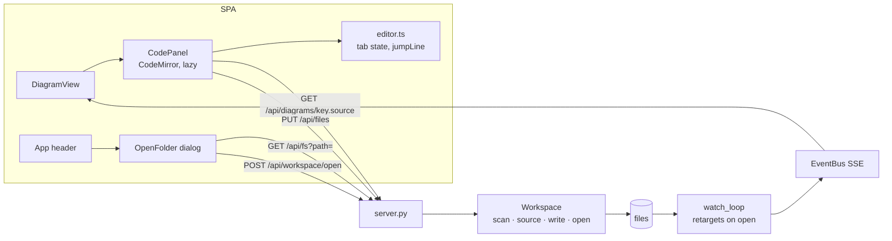

# Live editor — Design

**Spec**: `.specs/features/live-editor/spec.md` · **Context**: `context.md` · **Status**: Draft

## Architecture Overview

The `Workspace` (one per `serve`) gains a swappable root, a recursive scan and a file service; the server
adds four guarded endpoints; the SPA adds a code panel (CodeMirror 6, lazy chunk) and an Open-folder dialog.
Saving writes the file; the existing watcher sees the change and publishes `diagram` events, so the render and
the editor refresh through the paths that already exist.



Every new endpoint requires the header `X-Spinagram: 1`. No CORS headers are sent, so a page on another
origin cannot add the header (the preflight fails) and cannot write or read sources. The existing loopback bind
and `TrustedHostMiddleware` keep DNS rebinding out.

## Code Reuse Analysis

| Component | Location | How to use |
|---|---|---|
| `Workspace.scan / rescan / rel / key` | `src/spinagram/ui/workspace.py:103-140` | Make `scan` recursive; keys keep `rel#id`, so nested files get `sub/file.py#ID` for free |
| `Workspace.stylesheet_users` (sheet resolution) | `workspace.py:200-216` | Same resolution for the source tab list; extract `_sheet_path(d, sheet)` |
| `apply_changes / classify` | `server.py:183-218` | Generalise `p.parent in spec_dirs` to "under an open root and not skipped" |
| `watch_loop` restart-on-new-dirs | `server.py:221-235` | Add a retarget event so opening a folder restarts `awatch` on the new root |
| `_err`, `NO_STORE`, threadpool calls | `server.py` | Same response conventions for new routes |
| `hitTest`, styles report geometry + `attrs.label` | `web/src/Inspector.tsx`, `api.ts` | Click-to-jump reuses the inspector's hit test and the node's title |
| `useKey`, `useEvents`, `ApiError` | `web/src/hooks.ts`, `api.ts` | Cmd+S binding, live refresh, error display |
| `bun test` under pytest | `tests/test_web_unit.py` | Pure-logic tests for `editor.ts` |

## Components

### Workspace (extended) — `src/spinagram/ui/workspace.py`
- `scan() -> list[Path]`: recursive `os.walk` per directory root, sorted, pruning hidden dirs and `SKIP_DIRS`;
  stops at `MAX_SPECS` (2,000) and sets `self.truncated`.
- `contains(path) -> bool`: under a directory root (not inside a skipped dir) or equal to a file root.
- `open(path) -> None`: validates a directory, then under the lock swaps `paths`, clears files/caches, rescans.
  Raises `NotADirectoryError("not a directory: <path>")`.
- `source(key) -> list[SourceFile]`: spec file, then existing stylesheet files of the diagram's cascade
  (`d.stylesheets` already holds folder `_defaults` sheets first), de-duplicated.
- `write(path, text, version) -> str`: maps the display path to a file listed by any loaded diagram's source
  (else `PermissionError`), compares the SHA-256 version (else `VersionConflict(current)`), converts LF to the
  file's newline style, writes a temp file in the same folder and `os.replace`s it; returns the new version.

### File browser — `src/spinagram/ui/files.py` (new)
- `list_dir(path) -> dict`: `{path, parent, specs, dirs: [{name, path, specs}]}`; hidden and skipped dirs omitted;
  `NotADirectoryError` / `PermissionError` surface as messages.
- `SKIP_DIRS`, `MAX_SPECS`, `spec_count(dir)`, `read_source(path) -> SourceFile` (text, LF-normalised; version;
  newline; language from suffix).

### Server routes — `src/spinagram/ui/server.py`
| Route | Method | Result |
|---|---|---|
| `/api/diagrams/{key}.source` | GET | `{files: SourceFile[]}`; 404 unknown key; 422 spec error still lists the file |
| `/api/files` | PUT `{path, text, version}` | 200 `{version}`; 403 unlisted; 409 `{version}`; 413 > 1 MiB; 422 bad UTF-8/JSON |
| `/api/fs?path=` | GET | `list_dir` payload; 404 not a directory |
| `/api/workspace/open` | POST `{path}` | 200 summary; 404 `not a directory: <path>` (workspace unchanged); publishes `workspace` |
All four: 403 `missing X-Spinagram header` when the header is absent.

### SPA
- `web/src/editor.ts` (pure): `Tab` model and transitions `edit`, `saved`, `disk`, `reload`, `keepMine`;
  `jumpLine(text, title) -> number | null`; `languageOf(path)`.
- `web/src/CodePanel.tsx`: tabs with modified dot, CodeMirror view (lazy `import("./codemirror")`), Save button,
  Cmd/Ctrl+S, conflict banner, `beforeunload` + hash-change guard while dirty; refetches the source on every
  `rev` bump and feeds it through `disk`.
- `web/src/codemirror.ts`: builds the editor (basicSetup, python/css/yaml, light/dark theme); only module
  importing `@codemirror/*`, so it lands in its own chunk.
- `web/src/OpenFolder.tsx`: dialog (path box, parent, directory list with spec counts, trust note, Open).
- `DiagramView.tsx`: "Code" toggle (`e` key); when the code panel is open, a click on a node (outside inspect
  mode) hit-tests the styles report and asks the panel to jump.
- `App.tsx`: "Open folder" in the header with the current root; `DiagramsPage` shows the file path on cards,
  a truncation notice and "no diagrams in <path>".

## Data Models

```typescript
type SourceFile = { path: string; language: "python" | "css" | "yaml" | "text"; text: string; version: string };
type Tab = SourceFile & { disk: string; dirty: boolean; conflict: null | { text: string; version: string } };
type DirListing = { path: string; parent: string | null; specs: number; dirs: { name: string; path: string; specs: number }[] };
```

## Error Handling Strategy

| Error scenario | Handling | User impact |
|---|---|---|
| Save with stale version | 409 + current version; tab enters conflict | Banner: Reload from disk / Keep mine (Keep mine re-saves with the new version) |
| Spec fails to load after save | File is written; render returns 422 as today | Editor keeps text; red overlay names file and line |
| Unlisted path / missing header | 403, nothing written | Toast with the message (should not happen from the UI) |
| Body > 1 MiB / bad UTF-8 | 413 / 422 | Toast |
| Open a non-directory | 404, workspace unchanged | Dialog shows "not a directory: <path>" |
| Folder with > 2,000 specs | First 2,000 loaded, `truncated: true` | Catalog notice |
| Spec file deleted while open | Source 404 on refetch | Panel shows "file removed", Save disabled |

## Risks & Concerns

| Concern | Location | Impact | Mitigation |
|---|---|---|---|
| Writes from a browser to disk (CSRF) | new `PUT /api/files` | Another site could overwrite specs | `X-Spinagram` header + no CORS; path allow-list from loaded sources (SRC-04/06), tests for each |
| `watch_loop` only re-targets after a file event | `server.py:221-235` | After opening a folder, saves there would not be seen | Retarget event set by `open`; covered by a watcher test |
| Recursive scan of a huge tree | `workspace.scan` | Server hangs on `~` | Skip list + 2,000 cap + `truncated` |
| `classify` assumes flat spec folders | `server.py:184-196` | Nested specs not reloaded on save | Use `ws.contains`; test with a nested file |
| Bundle size | `web/` | Catalog pages slower | CodeMirror in a lazy chunk; check main chunk size stays within +10 % |
| Local bun 1.3.14 vs CI 1.4.2 | `web/` build | Stale-bundle CI failure | Build with `bunx bun@1.4.2` and `--frozen-lockfile` |

## Tech Decisions

| Decision | Choice | Rationale |
|---|---|---|
| Editor | CodeMirror 6 (`codemirror`, `@codemirror/lang-python`, `lang-css`, `lang-yaml`, `theme-one-dark`) | Modular, MIT, a few hundred KB vs Monaco's MBs |
| Version token | SHA-256 of the file bytes | No clock skew; identical content keeps the version |
| Path identity in the API | Display path as returned by `.source`, resolved against the allow-list | Client never sends absolute paths it invented |
| Folder swap | Replace the workspace root in place (no server restart) | SSE clients stay connected; watcher retargets |
