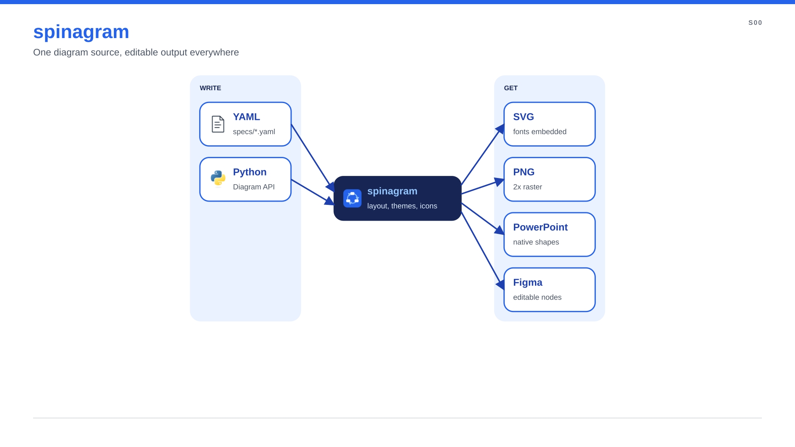
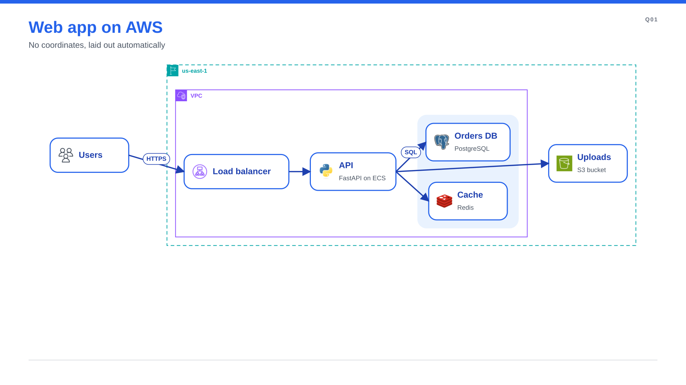

# spinagram

**Diagrams as code, delivered editable everywhere.** Describe boxes, groups and arrows in YAML or
Python; spinagram lays them out, applies your theme and writes SVG, PNG, PowerPoint slides with
native shapes, and Figma or FigJam nodes you can keep editing.



## Why spinagram

- **Editable output, not screenshots.** PowerPoint gets native shapes with the text inside and
  connectors bound to the boxes (move a box and the arrows follow). Figma gets real frames and nodes.
- **No coordinates needed.** Add `layout:` and spinagram sizes every box from its text and icon,
  nests groups such as an AWS Region, a VPC and its zones, and places everything.
- **Brand once, render anywhere.** A theme directory holds colours, fonts, node styles, icons and page
  chrome; the same source renders in any brand.
- **Thousands of icons.** AWS, GCP, Azure, Kubernetes, OCI, OpenStack and Terrastruct packs are
  downloaded on first use; add your own from a folder, npm or GitHub.
- **Built for reviews.** `spinagram check` catches text overflow, and numbers can come from a facts
  file with their provenance attached to every render.

## Your first diagram

=== "YAML"

    ```yaml title="examples/quickstart.yaml"
    --8<-- "examples/quickstart.yaml"
    ```

    ```bash
    spinagram render examples/quickstart.yaml -f svg,png,pptx -o out/
    ```

=== "Python"

    ```python title="examples/quickstart.py"
    --8<-- "examples/quickstart.py"
    ```

    ```bash
    python examples/quickstart.py
    ```

Both produce the same diagram:



Next: [install spinagram and render it yourself](getting-started.md).
